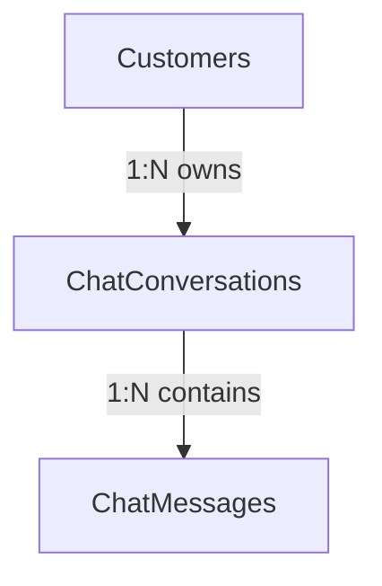

# MODULE 11 - AI Chatbot & Conversations

## 🎯 Mục tiêu Module

Module **AI Chatbot & Conversations** quản lý toàn bộ các phiên hội thoại, lịch sử tin nhắn và nhật ký thực thi công cụ (Function Calling Audit Trail) giữa Khách hàng (Customer) và Trợ lý ảo AI thông minh của Velocity (được vận hành bởi mô hình nền tảng **NVIDIA Nemotron-3.5-Super-VL-120B**).

Mục tiêu cốt lõi của thiết kế module này gồm:
* **Lưu trữ hội thoại bền vững (Persistence)**: Khách hàng tải lại trang (F5) hoặc chuyển đổi giữa các thiết bị (Web Dashboard, Mobile App) không bị mất ngữ cảnh trò chuyện trước đó.
* **Audit Trail cho Agentic AI**: Lưu vết chi tiết từng lượt AI quyết định gọi Tool nào (`tool_name`), tham số gì (`tool_args`), định danh cuộc gọi (`tool_call_id`) và kết quả truy vấn thực tế từ Database (`tool_result`).
* **Hỗ trợ Đa phương thức (Multimodal Vision)**: Cho phép lưu vết hình ảnh kiện hàng hư hỏng, phiếu gửi hàng (`image_url`) phục vụ việc phân tích khiếu nại bồi thường.
* **Bảo vệ quyền riêng tư & Ngữ cảnh độc lập**: Mỗi khách hàng sở hữu các cuộc hội thoại riêng biệt (`customer_id`), ngăn chặn triệt để nguy cơ rò rỉ dữ liệu chéo giữa các tài khoản.

---

## 📊 Các Bảng Trong Module (2 Bảng)

| STT | Bảng | Tên vật lý | Chức năng |
| :--- | :--- | :--- | :--- |
| 1 | `ChatConversations` | `chat_conversations` | Quản lý từng phiên hội thoại / cuộc trò chuyện của một khách hàng |
| 2 | `ChatMessages` | `chat_messages` | Lưu chi tiết từng tin nhắn, vết gọi Tool và kết quả phản hồi của AI |

---

## 🗺️ ERD Module



* **Ràng buộc toàn vẹn:**
  * Khóa ngoại `customer_id` trong `chat_conversations` tham chiếu đến `customers(id)` (`ON DELETE CASCADE`).
  * Khóa ngoại `conversation_id` trong `chat_messages` tham chiếu đến `chat_conversations(id)` (`ON DELETE CASCADE`).

---

## 🗄️ Chi Tiết Thiết Kế Bảng

### 1. Bảng: `chat_conversations` (Cuộc trò chuyện)

Bảng này đại diện cho một luồng trao đổi (Session / Conversation) giữa khách hàng và Trợ lý AI.

* **Các trường dữ liệu:**

| Field | PostgreSQL Type | Nullable | Default | Chức năng |
| :--- | :--- | :---: | :---: | :--- |
| `id` | UUID | ❌ | `gen_random_uuid()` | Khóa chính. |
| `customer_id` | UUID | ❌ | | FK → `customers(id)` (ON DELETE CASCADE). Khách hàng sở hữu cuộc trò chuyện. |
| `title` | VARCHAR(255) | ✅ | | Tiêu đề tóm tắt cuộc trò chuyện (tự động sinh từ câu hỏi đầu tiên, vd: *"Tra cứu đơn ORD-TD-046"*). |
| `status` | VARCHAR(30) | ❌ | `'ACTIVE'` | Trạng thái phiên chat (`ACTIVE`: đang hoạt động, `CLOSED`: đã đóng do hết thời gian chờ hoặc kết thúc). |
| `closed_at` | TIMESTAMPTZ | ✅ | | Thời điểm đóng phiên chat (khi hết 5 phút không phản hồi hoặc người dùng kết thúc). |
| `created_at` | TIMESTAMPTZ | ❌ | `NOW()` | Thời điểm bắt đầu cuộc trò chuyện. |
| `updated_at` | TIMESTAMPTZ | ❌ | `NOW()` | Thời điểm có tin nhắn mới nhất (phục vụ sắp xếp danh sách gần đây). |

* **Chỉ mục (Indexes):**
  * `idx_chat_conversations_customer`: `(customer_id, updated_at DESC)` phục vụ lấy nhanh các phiên chat mới nhất của khách hàng.
  * `idx_chat_conversations_status`: `(customer_id, status)` phục vụ tra cứu phiên chat đang mở (`ACTIVE`) của khách hàng.

---

### 2. Bảng: `chat_messages` (Chi tiết tin nhắn & Lịch sử Tool)

Bảng này lưu từng lượt trao đổi trong hội thoại, bao gồm tin nhắn của người dùng, phản hồi của AI, lượt kích hoạt Tool và kết quả DB tương ứng.

* **Các trường dữ liệu:**

| Field | PostgreSQL Type | Nullable | Default | Chức năng |
| :--- | :--- | :---: | :---: | :--- |
| `id` | UUID | ❌ | `gen_random_uuid()` | Khóa chính. |
| `conversation_id` | UUID | ❌ | | FK → `chat_conversations(id)` (ON DELETE CASCADE). Thuộc cuộc trò chuyện nào. |
| `role` | `chat_role_enum` | ❌ | | Vai trò người phát biểu (`USER`: khách hàng, `ASSISTANT`: AI, `TOOL`: kết quả trả về từ DB). |
| `content` | TEXT | ✅ | | Nội dung văn bản hiển thị. Cho phép null khi assistant chỉ kích hoạt gọi tool. |
| `image_url` | TEXT | ✅ | | Chuỗi Base64 hoặc URL ảnh chụp kiện hàng hư hỏng đính kèm. |
| `tool_call_id` | VARCHAR(100) | ✅ | | ID của lượt gọi tool từ AI (khớp giữa tin `ASSISTANT` và tin `TOOL`). |
| `tool_name` | VARCHAR(100) | ✅ | | Tên tool được gọi (vd: `track_order`, `estimate_shipping_fee`). |
| `tool_args` | JSONB | ✅ | | Tham số LLM gửi vào tool dưới dạng JSON. |
| `tool_result` | JSONB | ✅ | | Dữ liệu thực tế từ Database trả về cho Tool (đã mask dữ liệu nhạy cảm). |
| `status` | VARCHAR(30) | ✅ | `'SENT'` | Trạng thái tin nhắn (`SENT`, `OK`, `ERROR`, `NOT_FOUND`, `NOT_ALLOWED`). |
| `created_at` | TIMESTAMPTZ | ❌ | `NOW()` | Thời điểm gửi tin nhắn. |

* **Chỉ mục (Indexes):**
  * `idx_chat_messages_conversation`: `(conversation_id, created_at ASC)` phục vụ khôi phục toàn bộ dòng hội thoại theo thứ tự thời gian.

---

## 🏷️ Định Nghĩa ENUMs Trong Module

```sql
-- Vai trò của thực thể trong lượt chat
CREATE TYPE chat_role_enum AS ENUM (
  'USER',       -- Khách hàng người gửi
  'ASSISTANT',  -- Trợ lý ảo AI Nemotron
  'TOOL'        -- Kết quả thực thi hàm nghiệp vụ / DB trả về
);
```

